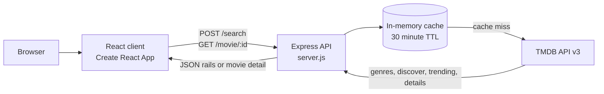

<div align="center">

# MoodFlix

Mood-first movie discovery: describe how you feel and MoodFlix returns popular films in five languages that match the mood.

[](LICENSE)
[](https://nodejs.org/)
[](https://expressjs.com/)
[](https://react.dev/)
[](https://www.themoviedb.org/)

</div>

## Overview

MoodFlix is a small full-stack application built around a simple idea: people often choose a film by how they feel, not by title, actor, or genre. The React client sends a free-text mood to an Express API. The API maps mood keywords to TMDB genres, discovers films in English, Hindi, Tamil, Telugu, and Marathi, and returns a separate popularity-ranked rail for each language. Selecting a film opens a detail view with its YouTube trailer and flat-rate streaming providers available in India.

The recommendation logic is deterministic keyword matching plus TMDB popularity data. It is not a machine-learning model and does not send user text to an LLM.

## Key Features

- **Mood-to-genre mapping.** A fixed mood dictionary maps terms such as `nostalgic`, `heartbroken`, `adventurous`, and `curious` to one or more TMDB genres.
- **Five language rails.** Every search returns English, Hindi, Tamil, Telugu, and Marathi collections.
- **Popularity-ranked results.** Each discover request pulls up to 20 pages of TMDB results, discards entries without posters, and sorts by popularity.
- **Trending fallback.** If a language/genre combination yields fewer than 150 films, the backend blends in the week's trending films for that language.
- **In-memory caching.** Genre lists, discover results, and trending results are cached for 30 minutes to reduce TMDB API traffic.
- **Trailer and provider details.** The detail endpoint appends TMDB videos and watch-provider data, returning the first YouTube trailer and India flat-rate providers.
- **Lightweight React UI.** A single-page client with a splash screen, horizontally scrollable rails, and a detail modal. No state-management or UI framework is required.

## How Recommendations Work

1. The client sends `{ "query": "<user text>" }` to `POST /search`.
2. `detectMood()` lowercases the query and returns the genres of the **first** mood whose key appears as a substring. Keys are evaluated in object order.
3. The mood's genre names are converted to TMDB genre IDs using `/genre/movie/list`.
4. For each of `en`, `hi`, `ta`, `te`, and `mr`, the server requests 20 pages of `/discover/movie` filtered by original language and those genre IDs, sorted by `popularity.desc`.
5. Results without a `poster_path` are removed. If fewer than 150 films remain for a language, up to three pages of `/trending/movie/week` for that language are appended.
6. Each language array is sorted by popularity and returned. The client renders the first 30 items per rail.

Because the query is only used for mood detection, arbitrary text such as an actor or film title does not perform a title search. If no mood keyword matches, the server returns popular films in each language without a genre filter.

## Architecture



The server is stateless apart from the module-level cache, so restarting it clears all cached TMDB responses.

## Tech Stack

| Layer | Technology |
| :--- | :--- |
| Client | React 19, Create React App 5 (`react-scripts`), Axios |
| Server | Node.js, Express 5, Axios, CORS, dotenv |
| Data source | TMDB API v3 (metadata and images) |
| Optional/local storage | SQLite 3 via the `sqlite3` dependency; `movies.db` and `favorites.db` exist locally but are not used by the current server |
| Styling | Plain CSS in `client/src/App.css` |
| Deployment | GitHub Pages configuration for the client; the client source currently points at a Render-hosted backend |

## Project Structure

```text
MoodFlix/
├── server.js                 # Express API: /search and /movie/:id
├── package.json              # Backend dependencies
├── .env.example              # Required environment variables (template)
├── movies.db                 # Local SQLite file (gitignored, not read by server.js)
├── favorites.db              # Local SQLite file (gitignored, not read by server.js)
├── build/                    # Legacy static build output (not served by server.js)
└── client/
    ├── package.json          # React scripts and GitHub Pages deployment
    ├── public/               # CRA public assets
    └── src/
        ├── App.js            # Search, rails, and detail modal
        ├── App.css           # Application styles
        ├── App.test.js       # Default CRA smoke test
        └── index.js          # React entry point
```

## Prerequisites

- **Node.js 18 or newer** and npm. Express 5 requires a current Node.js release.
- A **TMDB API key** (v3 auth). Create an account and request a key from your [TMDB API settings](https://www.themoviedb.org/settings/api).
- A modern browser.

## Setup

### 1. Clone the repository

```bash
git clone https://github.com/ishanvaidya01/MoodFlix.git
cd MoodFlix
```

### 2. Install backend dependencies

```bash
npm install
```

### 3. Configure the server environment

Create `.env` in the repository root from the template:

```bash
# macOS / Linux
cp .env.example .env

# Windows PowerShell
Copy-Item .env.example .env
```

Set `TMDB_KEY` to your own TMDB API key. Never commit `.env`.

### 4. Start the backend

```bash
node server.js
```

The API listens on `http://localhost:5000` by default. There is no `start` script in the root `package.json`, so run the server file directly.

### 5. Install and start the client

In a second terminal:

```bash
cd client
npm install
npm start
```

The development server opens `http://localhost:3000`.

### 6. Point the client at your local API for development

The client does not read an environment variable for its API URL. The base URL is the `BACKEND` constant in `client/src/App.js`, currently set to a deployed Render service. To develop entirely locally, change that constant to `http://localhost:5000` (this is a source change and is not required to read this documentation). Restore or replace it with your own deployed API URL before building for production.

## Environment Variables

| Variable | Required | Default | Description |
| :--- | :---: | :--- | :--- |
| `TMDB_KEY` | Yes | — | TMDB API v3 key used by every backend TMDB request. The server exits at startup if it is missing. |
| `PORT` | No | `5000` | HTTP port for the Express server. |

An existing local `.env` may contain other keys (for example `HF_KEY`), but the current code does not read them. Keep only variables the application uses and never commit the file.

## Run Commands

| Location | Command | Purpose |
| :--- | :--- | :--- |
| Repository root | `npm install` | Install backend dependencies |
| Repository root | `node server.js` | Start the API on port 5000 (or `PORT`) |
| `client/` | `npm install` | Install client dependencies |
| `client/` | `npm start` | Start the CRA development server on port 3000 |
| `client/` | `npm run build` | Produce a production build in `client/build/` |
| `client/` | `npm test` | Run the CRA/Jest test watcher |
| `client/` | `npm run deploy` | Build and publish `client/build/` to GitHub Pages via `gh-pages` |

## Usage

1. Open the client and wait for the splash screen to finish.
2. Enter a mood phrase, for example `I feel nostalgic tonight`, and submit.
3. Browse the English, Hindi, Tamil, Telugu, and Marathi rails. Use the arrow buttons to scroll a rail horizontally.
4. Select a poster to load details. If TMDB has a YouTube trailer, it plays in the modal; the detail response also includes flat-rate watch providers for India.
5. Change the text and search again to load a different mood.

Example request:

```bash
curl -X POST http://localhost:5000/search \
  -H "Content-Type: application/json" \
  -d "{\"query\":\"feeling adventurous\"}"
```

## API Endpoints

### `POST /search`

Accepts a JSON body with a `query` string and returns five arrays.

**Request body**

```json
{
  "query": "feeling adventurous"
}
```

**Response shape**

```json
{
  "english": [{ "id": 0, "title": "Example", "poster_path": "/example.jpg", "popularity": 123.4 }],
  "hindi": [],
  "tamil": [],
  "telugu": [],
  "marathi": []
}
```

The objects are the standard TMDB movie-list fields; the example above is abbreviated. On an upstream failure the endpoint returns `500` with `{ "error": "Search failed" }`.

### `GET /movie/:id`

Returns TMDB movie details with two additions:

- `trailerKey` — the YouTube key of the first result whose `type` is `Trailer` and `site` is `YouTube`, or `null`.
- `providers` — the `flatrate` watch providers for the `IN` (India) region, or an empty array.

TMDB requests append `videos` and `watch/providers`. On failure the endpoint returns `500` with `{ "error": "Details failed" }`.

There is no health, authentication, or favorites endpoint in the current server.

## Data and Local SQLite Files

`movies.db` and `favorites.db` are local SQLite files that are ignored by Git. Both contain a `favorites` table, suggesting they were created for an earlier favorites experiment. **The current `server.js` does not open either database and no API route depends on them.** They are not required to run MoodFlix and can be kept as local artifacts or removed from a working copy without affecting the application.

The root `build/` directory and `client/build/` contain generated static assets from earlier builds. The Express server does not serve them; use `cd client && npm start` for development or `cd client && npm run build` to rebuild the client.

## Testing

There is no configured backend test suite. The root `npm test` script is a placeholder that prints an error and exits with status 1, so it is not a useful verification step. The client includes the default Create React App smoke test:

```bash
cd client
npm test
```

No lint script is defined in either package.

## Deployment

- **Client:** `client/package.json` declares the GitHub Pages homepage `https://ishanvaidya01.github.io/MoodFlix` and uses `gh-pages` in a `deploy` script. After setting the client's `BACKEND` constant to a reachable API, run `cd client && npm run deploy`. The `predeploy` hook builds the app first.
- **Backend:** there is no Dockerfile, Procfile, or platform configuration in the repository. The checked-in client currently points at `https://moodflix-backend-kztp.onrender.com`, which implies a Render deployment, but the deployment configuration is not part of this repo. Deploy `server.js` to any Node.js host, set `TMDB_KEY`, and update the client's `BACKEND` constant to that URL.

CORS is currently enabled for all origins. Add origin restrictions and rate limiting before exposing the API as a public production service.

## Limitations and Disclaimers

- Mood detection is keyword matching, not sentiment analysis. Only the first matching key wins, and multi-mood phrases are reduced to one genre set.
- Search text is not used for title, cast, or keyword lookup.
- Each request can make up to 100 TMDB discover calls (20 pages × 5 languages) plus trending calls on a cache miss. The 30-minute cache limits repeated traffic but not the first request.
- Trending results are appended without deduplication, so a title can appear more than once in a rail.
- Watch providers are fetched only for India. Availability changes and is controlled by TMDB/JustWatch.
- There is no authentication, user account, database-backed favorites feature, or server-side persistence in the current code.

**TMDB attribution:** This product uses the TMDB API but is not endorsed or certified by TMDB. Movie metadata and images are supplied by [The Movie Database](https://www.themoviedb.org/). Review TMDB's terms before deploying publicly.

## Contributing

Contributions are welcome. Read [CONTRIBUTING.md](CONTRIBUTING.md) for setup, branch naming, commit conventions, and the pull-request checklist. By participating, you agree to follow [CODE_OF_CONDUCT.md](CODE_OF_CONDUCT.md). Report security issues privately as described in [SECURITY.md](SECURITY.md).

## License

Released under the [MIT License](LICENSE). Copyright (c) 2026 Ishan Vaidya.

## Contact

Maintained by **Ishan Vaidya** — [ishan.vaidya01@gmail.com](mailto:ishan.vaidya01@gmail.com) — [github.com/ishanvaidya01](https://github.com/ishanvaidya01).
