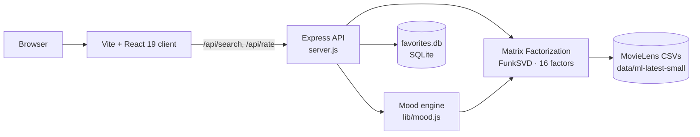

<div align="center">

# MoodFlix

Cinema shaped by emotion — an offline, mood-aware movie recommender powered by a **matrix-factorization ML model trained on real MovieLens ratings**. No API keys, no cloud, everything runs on your machine.

[](LICENSE)
[](CONTRIBUTING.md)
[](https://nodejs.org/)
[](https://expressjs.com/)
[](https://react.dev/)
[](https://grouplens.org/datasets/movielens/)

</div>

## Overview

MoodFlix answers one question: *what should I watch given how I feel right now?*

Describe your mood in free text — "heartbroken", "mind bending please", "cozy monsoon evening" — and a locally trained **FunkSVD matrix-factorization model** combined with a mood engine ranks the MovieLens film catalog for you. Every card explains *why* it was picked (mood match, your learned taste, community quality), and every star rating you leave **updates your personal taste vector live** — the model literally retrains as you rate.

Accuracy is measured, not asserted: the `/api/model` endpoint reports held-out evaluation metrics computed on 10% of ratings the model never trained on.

## Model Card

| Metric | Value (held-out 10%) |
| :--- | :---: |
| RMSE | **0.870** |
| MAE | **0.67** |
| Precision@10 | **65.2%** (of top-10 predictions rated ≥ 4★) |
| Ratings trained on | 90,753 |
| Held-out ratings | 10,083 |
| Latent factors | 16 |
| Epochs (SGD) | 14 |
| Learning rate / regularization | 0.008 / 0.06 |

The prediction model is the classic FunkSVD formulation:

```
r̂(u,i) = μ + b_u + b_i + p_u · q_i
```

trained with plain SGD on the MovieLens ratings matrix.

## Key Features

- **Real ML, not keyword matching.** A matrix-factorization recommender trained on 100,836 real MovieLens ratings runs entirely in Node.
- **Mood engine.** A pure, unit-tested module maps free-form emotional input onto MovieLens genre weights with phrase matching, synonym groups, and negation handling ("not scary").
- **Explainable scoring.** Every pick shows mood match, your taste match, and community quality — the ranking is never a black box.
- **Live taste learning.** Star ratings take incremental SGD steps on your personal taste vector; `/api/profile` shows your learned genre affinities.
- **Diversity re-ranking.** A genre-aware MMR pass prevents single-genre walls of recommendations.
- **Similar by learned structure.** "More like this" uses cosine similarity in the model's latent item space, not TMDB keywords.
- **Zero API keys.** IMDb deep-links from the MovieLens `links.csv`; gradient "posters" are generated deterministically from title hashes.
- **Local persistence.** Favorites live in SQLite; a stable per-browser user id keeps your taste profile across visits.

## Architecture



## Tech Stack

| Layer | Technology |
| :--- | :--- |
| Client | React 19, Vite 6, Tailwind CSS 3, Axios |
| Server | Node.js 18+, Express 5, CORS, compression, helmet |
| ML core | Custom FunkSVD matrix factorization (`lib/recommender.js`) with SGD, bias terms, held-out evaluation, and MMR diversity re-ranking |
| Dataset | [MovieLens ml-latest-small](https://grouplens.org/datasets/movielens/) — 9,742 movies, 100,836 ratings (GroupLens, auto-downloaded) |
| Persistence | SQLite 3 (`favorites.db`) |
| Tests | Node.js built-in test runner (`node --test`) |

## Project Structure

```text
MoodFlix/
├── server.js                 # Express API: search, recommend, rate, favorites, profile
├── lib/
│   ├── recommender.js        # ML core: FunkSVD training, scoring, diversity, eval
│   ├── mood.js               # pure mood → genre-weights engine (unit tested)
│   └── data.js               # MovieLens CSV parsing + Bayesian per-film stats
├── scripts/
│   └── prepare-data.js       # downloads & unpacks the MovieLens zip (run once)
├── tests/                    # node --test suites for mood + recommender
├── data/ml-latest-small/     # dataset (gitignored, created by data:prepare)
├── favorites.db              # local favorites store (gitignored)
└── client/                   # Vite + React 19 + Tailwind front end
    ├── index.html
    ├── vite.config.js        # base /MoodFlix/ for GitHub Pages
    ├── tailwind.config.js
    ├── postcss.config.js
    └── src/
        ├── App.jsx           # landing / results / profile wiring
        ├── api.js            # API client + per-browser user id
        └── components/       # Poster, MovieCard, MovieModal, ResultsStrip
```

## Prerequisites

- **Node.js 18 or newer** and npm.
- That's it. No API keys, no accounts.

## Setup

### 1. Clone and install

```bash
git clone https://github.com/ishanvaidya01/MoodFlix.git
cd MoodFlix
npm install
```

### 2. Fetch the dataset (once per machine)

```bash
npm run data:prepare
```

Downloads the ~1 MB MovieLens `ml-latest-small` zip from GroupLens and unpacks `movies.csv`, `ratings.csv`, and `links.csv` into `data/ml-latest-small/`. If your network blocks the download, grab the zip manually from the [MovieLens page](https://grouplens.org/datasets/movielens/) and place the three CSVs there yourself.

### 3. Start the API

```bash
npm start
```

On boot the server trains the model (~seconds, metrics logged) and serves `http://localhost:5000`.

### 4. Start the client

In a second terminal:

```bash
cd client
npm install
npm run dev
```

Open `http://localhost:5173`. The client talks to `http://localhost:5000` by default (override with `VITE_API_URL`).

## Environment Variables

Copy `.env.example` to `.env` if you want to override defaults. **Nothing is required** — the app runs with zero configuration.

| Variable | Required | Default | Description |
| :--- | :---: | :--- | :--- |
| `PORT` | No | `5000` | HTTP port for the Express API. |
| `MOODLENS_URL` | No | GroupLens URL | Alternate download URL for the dataset zip. |
| `MOODFLIX_DATA_DIR` | No | `data/ml-latest-small` | Dataset location. |
| `MF_FACTORS` | No | `16` | Latent factor count for the model. |
| `MF_EPOCHS` | No | `14` | Training epochs. |
| `MOODFLIX_DB` | No | `favorites.db` | SQLite favorites database path. |

Client (in `client/`): `VITE_API_URL` (default `http://localhost:5000`), `VITE_BASE` (default `/MoodFlix/` — set to `/` for other static hosts).

## API Endpoints

All routes are prefixed with `/api`.

| Method | Route | Description |
| :--- | :--- | :--- |
| GET | `/api/health` | Liveness + dataset/model status |
| GET | `/api/model` | Approach, hyperparameters, held-out RMSE/MAE/P@10 |
| POST | `/api/search` | `{ query, userId? }` → mood-aware ranked results with `why[]` explanations |
| GET | `/api/recommend` | Cold-start picks (no query needed) |
| GET | `/api/movie/:id` | Details, IMDb URL, latent-space neighbors |
| GET | `/api/moods` | Mood chips: ids, sample phrases, mapped genres |
| POST | `/api/rate` | `{ movieId, rating, userId? }` → live SGD update of your taste vector |
| GET | `/api/profile` | Top genre affinities learned for `userId` |
| GET/POST | `/api/favorites` | List / add favorites (SQLite) |
| DELETE | `/api/favorites/:id` | Remove a favorite |

Example:

```bash
curl -X POST http://localhost:5000/api/search \
  -H "Content-Type: application/json" \
  -d "{\"query\":\"feeling adventurous\"}"
```

## Testing

```bash
npm test          # runs node --test over tests/
```

Covers mood phrase matching, negation suppression, MF convergence (sub-0.9 RMSE on a synthetic set), ranked-list shape with explanations, genre diversity, taste-profile shifts from ratings, and similarity ordering.

## Deployment

- **Client:** `client/package.json` declares the GitHub Pages homepage and a `deploy` script: `cd client && npm run deploy`. `vite.config.js` sets `base: '/MoodFlix/'` for project pages; set `VITE_BASE=/` when hosting elsewhere.
- **Backend:** runs anywhere Node 18+ does — `npm start`. No external services required. (GitHub Pages hosts only the static client; keep the API local.)

## Limitations and Disclaimers

- The film catalog is the MovieLens `ml-latest-small` collection (~9,700 films), so very recent or niche titles are not included.
- Personality: recommendations are shaped by aggregated crowd ratings plus your local ratings; a brand-new profile starts semi-cold and sharpens after a handful of ratings.
- Rate limiting (simple fixed window) is enabled; CORS is open to all origins by design because the app is meant to run locally.

**Dataset attribution:** This product uses the MovieLens dataset collected by the [GroupLens Research Project](https://grouplens.org/datasets/movielens/) at the University of Minnesota. It is not endorsed or certified by GroupLens. IMDb links are constructed from dataset `links.csv`; IMDb is not affiliated with this project.

## Contributing

Contributions are welcome. Read [CONTRIBUTING.md](CONTRIBUTING.md) for setup, branch naming, commit conventions, and the pull-request checklist. By participating, you agree to follow [CODE_OF_CONDUCT.md](CODE_OF_CONDUCT.md). Report security issues privately as described in [SECURITY.md](SECURITY.md).

## License

Released under the [MIT License](LICENSE). Copyright (c) 2026 Ishan Vaidya.

## Contact

Maintained by **Ishan Vaidya** — [ishan.vaidya01@gmail.com](mailto:ishan.vaidya01@gmail.com) — [github.com/ishanvaidya01](https://github.com/ishanvaidya01).
